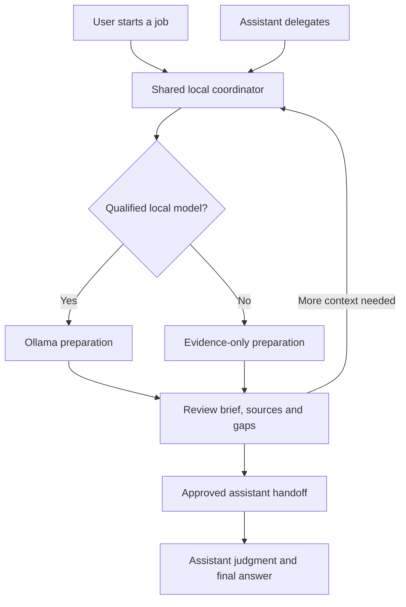

# Whole-workflow user experience

November 4, 2026 · source-informed design plan for Shake and Bake.

This plan joins setup, local preparation, evidence review, assistant handoff and recovery into one product journey. It is grounded in the current HTML/JavaScript, GUI controller, helper and prepared SDK adapter. It is not a screenshot audit or a completed user test. Earlier automatic approval review blocked cloud-browser inspection because it could expose project data; no alternate browser route was attempted. Desktop/phone behavior and accessibility still need direct testing.

## The experience we want

A user should be able to choose a job, choose permitted source, see what the local helper actually did, inspect the evidence and gaps, and hand the unresolved judgment to their chosen assistant. The primary screen should make three things clear: what is happening, what is trustworthy or missing, and the next useful action. Model names and technical settings remain expandable.

Two entry points must serve the same job: a person starting in the GUI, or an assistant delegating through a qualified adapter. The core owns the project permissions, task identity, model policy, status, evidence and pause controls. The GUI explains that state; the adapter requests bounded work. The shared coordinator is implemented for explicit shared mode in 0.4.0.dev4; native clients are tested. Actual SDK/host qualification and the complete guided setup/persistence journey remain pending.

The diagram is the proposed connected workflow. Actual host integration remains unqualified. The current app supports explicit manual copy/export; that does not establish delivery to a host or a completed final answer.

## What the source shows now

| Flow step | Current state | Source observation / design consequence |
| --- | --- | --- |
| 1. Open and understand the app | Partial | The GUI provides a demo, task cards and model/evidence views. Real projects are configured through launch arguments in `gui.py::main`; guided source/setup selection is missing. |
| 2. Check this computer/model | Partial | Doctor and inventory checks exist; calibration and device-profile management are planned. The workflow needs a clear next action when no model is installed or qualified. |
| 3. Start a job | Shared core implemented; host qualification pending | Shared-mode adapter clients connect through private scoped RPC to the GUI Controller, sharing one routed HelperSession, job registry and session pause. Explicit standalone diagnostics remain separate. See shared-coordinator.md. |
| 4. Prepare and monitor | Implemented contracts; browser behavior unverified | The GUI polls actual status and offers cancellation; the core bounds jobs. A human-readable stage/status contract must cover both entry points. |
| 5. Review a brief | Implemented data views; workflow risks remain | Exact excerpts, hashes, gaps and unverified model notes are shown. `app.js::startTask` retains the previous result; failed/cancelled `showResult` returns before replacing it. The interface now pins completed request/job identity and labels an earlier brief during a new or failed/cancelled job. This mitigation is implemented in source; browser/user testing remains pending. |
| 6. Handoff to the assistant | Manual copy/export implemented; connection pending | Clipboard/download actions exist. The SDK/host path is not qualified; copy success cannot be labeled host delivery or final-task completion. |
| 7. Return, retry or restart | Partial | Question drafts use browser localStorage. History, captured evidence and local-AI switch state are session-only; `Controller` starts with `disabled=False`. Users need explicit retention/reset information and a deliberate persistent-settings design. |

Useful foundations already exist: job-first task choices; exact source kept alongside notes; published model statistics separated from local records; no candidate silently treated as a qualified winner; and an evidence-only path when model preparation is unavailable. These controls need one understandable path through them.

## Target journey, step by step

1. **First visit: Try a demo or Set up this PC.** The demo teaches the handoff without needing a download. Clearly distinguish recorded preview, live synthetic demo and a real-source job. Returning users can start a job directly.
2. **Readiness: one problem and one action at a time.** Show source permissions, local service, installed models and measured/unknown capabilities. Missing optional AI should leave evidence-only preparation usable. Unsupported platforms and unavailable required source need an explicit explanation.
3. **Compose: choose the outcome and source.** Show Code, Troubleshoot, Documents or Search, a concrete question, an approved working folder and the intended handoff destination. Keep a concise summary of scope, chosen preparation mode and important unknowns beside the main action. Avoid requiring users to understand model tags to begin.
4. **Prepare: report actual stages.** Use plain states such as Checking source, Gathering evidence and Organizing locally, derived from backend events. Show actual completed counts when available; no invented percentage or ETA. Stop/cancel must describe whether only the client/owned runner stopped and what remains unknown about the daemon.
5. **Inspect: a compact brief with expandable proof.** Pin the original request, job ID, task category and captured source identity. Make facts, model interpretation, contradictions and missing context distinct. A preparation result is labeled Brief prepared or Evidence gathered; it is not Bug fixed or Final answer ready.
6. **Handoff: show what will leave the PC.** Keep manual Copy brief honest about the next paste step. Future connected Send controls require a qualified destination and a source/scope preview. Mark delivery only from an actual acknowledgement. Private-source handling must meet its own security gate.
7. **Continue: ask for more evidence or review the host result.** Preserve the original request and captured brief. A follow-up creates a new linked job/source check when needed. Final answer received requires a real host result or an explicit user record, not a copied clipboard.
8. **Return safely.** Show what was saved, what expires and what needs rechecking. A stale source/model/runtime profile cannot look current. Resume is offered only where durable recovery exists; otherwise preserve the request and offer a clearly new run. Saving/clearing private drafts and remembering the AI-off choice need explicit controls.

## One coordinator and one state contract

Shared-mode GUI and native adapter clients now use one authenticated local controller with the same admission and model-policy rules. Actual SDK and host connections still require qualification. Preserve the existing approved-project-ID boundary and give each client only the fields/permissions it needs. Do not expose the service publicly to solve the UI integration problem.

Each job should carry: job/request identity, source scope/snapshot, preparation mode/profile identity, stage, terminal outcome, evidence/gaps, usage origin and handoff status. Separate a new editable draft from the last completed result. Changes to a draft do not rewrite a previous receipt or silently change the model explanation for that receipt.

The local-AI pause control should have a defined product-wide scope within this service, including assistant-originated jobs, and show acknowledgement. It does not control unrelated services or attest that Ollama stopped GPU work. Persistent preferences, source permissions and qualification records must have explicit versioning and restart behavior. Shared jobs and session pause are implemented in shared mode; persistence and the full restart/settings experience remain planned.

## Failure and empty states

| Situation | Required user-facing state and next action |
| --- | --- |
| No installed or qualified model | Say what was checked and why no model ran. Offer evidence-only preparation or the guided local-model trial/setup path. Never invent a winner. |
| Missing permission or unusable source | Identify the permitted source problem and offer a source choice/scope correction. Keep unrelated host files outside the task. |
| Partial evidence or contradictory code | Show what was collected and missing. Offer a targeted follow-up; do not certify repository-wide completeness. |
| Local model timeout or identity change | Retain exact evidence, show the failed attempt and explain the next check. No silent substitute or retry loop. |
| Busy/expired/disconnected request | Translate the condition into a concrete action. Keep the last completed result clearly labeled and let the user reopen actual job status where retained. |
| Host not connected | Offer manual copy/export as such; keep Final answer pending. |
| New draft while an older result exists | Display both identities clearly; copy/export always names its completed job. A failed new task must not make the older brief appear to be its result. |
| Restart or expired session | Explain which preferences, drafts, jobs and evidence survived. Do not imply recovery where only a browser draft was saved. |

## Visuals that explain the work

Keep the vivid task cards and evidence map. Add one consistent job-stage strip, source/model/handoff status cards and expandable details rather than several competing success badges. Color is accompanied by text; unknown values are labeled. Animation represents a real stage or a labeled conceptual diagram, never an invented measurement.

Model details have separate This PC, Publisher results, Why selected and License & source sections. Comparison charts require comparable measured cohorts, settings, units and dates; otherwise show the reason a comparison is unavailable. The main task view stays compact while source receipts, hardware/runtime, hashes and advanced controls remain available on demand.

## First implementation slices

1. **Shared job/policy/pause semantics:** design the local service contract and qualified adapter bridge; prove both entry points observe the same job and permissions.
2. **Guided first useful run:** demo, approved source selection, readiness checks and a clear unqualified-model path without hand-editing policy files as the normal beginner flow.
3. **Pinned result and recovery states:** separate drafts/active jobs/completed briefs; use actionable errors and explicit retention/restart behavior.
4. **Honest handoff:** preview/copy first, then actual qualified host delivery and acknowledgement; preserve evidence and gaps.
5. **Calibration and detail views:** add the planned hardware/profile/license views using actual backend records, followed by desktop/phone and accessibility review.

These are product/engineering priorities in parallel with the accuracy trial. The first shared-core slice plus first-run help and result identity are now implemented; the remaining guided setup, persistent profiles and actual host-delivery UI are still planned.

## Task-based acceptance checks

- [ ] A first-time user can complete the inert demo and explain what the helper did and what still requires the assistant.
- [ ] A returning user can pick an approved project/job without losing the prior result or unknowingly using an old brief.
- [ ] A user can tell whether Ollama actually ran, why a profile was selected or rejected, and what evidence remains missing.
- [ ] GUI and qualified adapter actions use matching job state, model gates, permissions and pause behavior.
- [ ] Missing models, busy service, timeouts, cancellation and stale profiles each provide a specific next action and preserve useful evidence.
- [ ] Before a connected handoff, the user can understand what leaves the PC; copied, delivered and answered states remain distinct.
- [ ] Draft/history/settings retention and restart behavior are understandable and match actual storage/permissions.
- [ ] Desktop/phone, keyboard, focus, disclosures, reduced motion, status announcements and copy/export are tested in the actual app.
- [ ] Observations from real task walkthroughs are recorded; program tests and attractive visuals alone do not close UX-01 or UI-01.
