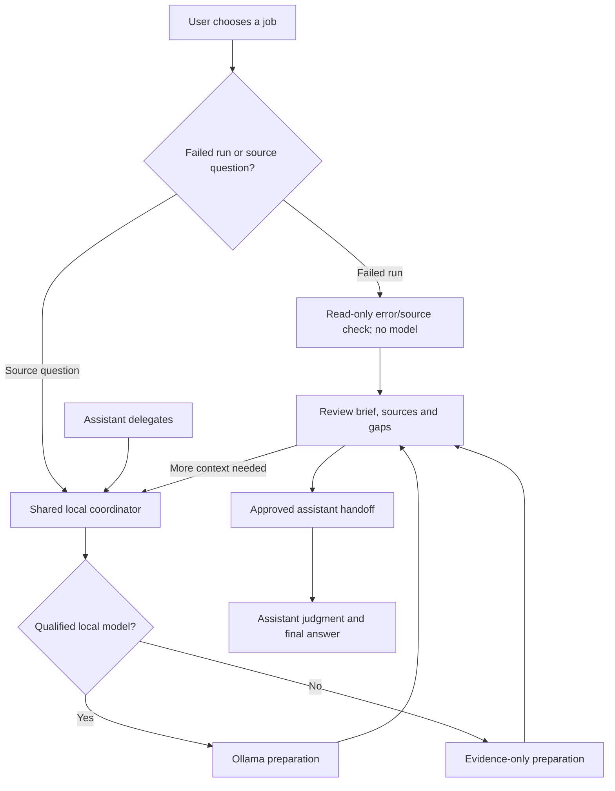

# Whole-workflow user experience

Original design plan: November 4, 2026. Implementation status refreshed November 11 for the reviewed `0.4.0.dev37` source. [Current status](current-status.md) separates that source and its validation from delivery to main or an owner installation. Use the [workbench guide](visual-workbench.md) for active instructions and [evaluation status](evaluation-status.md) for model/host evidence.

This plan joins setup, local preparation, evidence review, assistant handoff and recovery into one product journey. It separates implemented controls from proposed calibration, dashboards, durable recovery and connected delivery. The earlier blocked cloud-browser inspection remains a historical limitation of that attempt. Later [installed readiness](pc-readiness-2026-11-05.md) and [copy recovery](copy-and-screening-2026-11-05.md) cover their stated versions and selected flows.

The dev36 [workbench follow-up](workbench-usability-2026-11-11.md) records screenshots, interaction review, compact workflows, optional run details, contextual folder connection, shared activity and exact copy/error identity. The dev37 [recovery follow-up](captured-report-recovery-2026-11-11.md) records retained reports/JSON, truthful source history and initial mode gating. These are scoped synthetic checks, not representative usability or full accessibility qualification. The acceptance checklist below remains a broader qualification target.

## The experience we want

A user should be able to start with a failed run or source question, prepare evidence from explicitly permitted source, and copy it into an existing assistant chat. The primary screen should make three things clear: what the app does, what source it uses, and the next useful action. Failed-run command/working-folder inputs belong in **Run details (optional)**. Source-task type, draft controls and optional models belong in **Options**; ordinary evidence-only use requires neither disclosure. Source review, exports and recent briefs remain available on demand.

Source preparation has two entry points: a person starting in the GUI, or an assistant delegating through an explicitly scoped adapter. The failed-run source check is a separate GUI workflow. The core owns project permissions, task identity, model policy, status, evidence and pause controls. The GUI explains that state; the adapter requests bounded work without inheriting newly connected browser folders. Shared coordination was implemented for explicit shared mode in dev4. SDK 2.3.0 and scoped Codex synthetic handoff/cancellation checks have evidence; broader host qualification and full guided setup/persistence remain pending.

The diagram is the target connected workflow. Actual host evidence is limited to the scoped Codex synthetic handoff/cancellation check; broader integration remains unqualified. The current app supports explicit manual copy/export; that does not establish delivery to a host or a completed final answer.

## What the source shows now

| Flow step | Current state | Source observation / design consequence |
| --- | --- | --- |
| 1. Open and understand the app | Two job-first workflows implemented; broader onboarding qualification open | **Diagnose a failed run** accepts pasted/loaded errors; **Prepare source brief** accepts a request. **Connect folder** beside either project selector opens the shared absolute-path form and explicitly authorizes read-only session use. Launch-time projects remain supported. Model installation/setup automation remains planned. |
| 2. Check this computer/model | Explicit metadata checks implemented; calibration planned | **Options → Model details → This computer & selected model** exposes **Check this computer** and **Check selected model**. Unknown fit/accuracy stays unknown. Either normal workflow remains usable without a model. Automatic calibration and saved per-PC profiles remain planned. |
| 3. Start a job | Shared core and scoped Codex check verified; broader host qualification pending | Shared-mode adapter clients connect through private scoped RPC to the GUI Controller, sharing one routed HelperSession, job registry and session pause. Explicit standalone diagnostics remain separate. See shared-coordinator.md. |
| 4. Prepare and monitor | Actual shared activity and cancellation implemented | A source-job notice reports starting, running or unknown status across workflows. **View preparation** reveals the existing job and **Stop**; conflicting failed-run submission waits while inputs remain editable. The backend does not expose granular gathering/model stages or a percentage/ETA. |
| 5. Review evidence | Captured identity, gaps and retry retention implemented; broader user qualification open | Source briefs pin request/job identity. Failed-run reports retain exact error, project/working folder, source, hashes and explicit error/frame associations. The last accepted report stays visible through pending/failed/obsolete checks; only a valid current response replaces it. Earlier-capture notices distinguish it from newer edits. |
| 6. Handoff to the assistant | Manual copy/export implemented and scoped checks recorded | Source briefs offer **Starting points (default)** or **Full evidence, cited answer**, with **Review & export**. Failed runs offer **Copy debugging brief** and exact captured JSON even when a recheck fails or inputs differ. Copy feedback follows exact text/job identity; one unsettled write is shared across workflows. Actual host delivery and final answers remain separate. See [handoff](assistant-handoff.md). |
| 7. Return, retry or restart | Browser controls and session renewal implemented; durable jobs planned | Source drafts have saving opt-out/**Clear draft**; mode/candidate choices use separate browser preferences. Normal GUI Local AI on/off persists privately. One failed-run report stays in the open tab; source jobs stay in the limited running-session history. **Retry connection** renews an expired same-address session without reloading or replaying work; expired approvals/jobs are not restored. |

Useful foundations already exist: job-first task choices; exact source kept alongside notes; published model statistics separated from local records; no candidate silently treated as a qualified winner; and an evidence-only path when model preparation is unavailable. These controls need one understandable path through them.

Source preparation currently admits up to ten records: four primary windows plus up to six software-selected context windows (four definition, one usage and one test). Byte, source and selection limits can reduce this set; it is not ten guaranteed files or complete coverage. [Optional embedding reranking](embedding-rerank-2026-11-07.md) is implemented for explicit CLI/benchmark use, remains off by default and is not a GUI switch. It reorders already permitted candidates; it does not authorize roots, answer the question or qualify accuracy.

## Target journey, step by step

1. **First visit: Try a demo or Set up this PC.** The demo teaches the handoff without needing a download. Clearly distinguish recorded preview, live synthetic demo and a real-source job. Returning users can start a job directly.
2. **Readiness: one problem and one action at a time.** Show source permissions, local service, installed models and measured/unknown capabilities. Missing optional AI should leave evidence-only preparation usable. Unsupported platforms and unavailable required source need an explicit explanation.
3. **Compose: describe the task and confirm the source.** Show a concrete question, an approved project and Prepare brief. Keep task type and optional AI under Options, preserving saved choices. Task type selects a model profile but does not alter deterministic collection. Reveal unavailable saved choices or trial acknowledgement controls when they need attention. The handoff uses the user's existing assistant chat; no destination selector is needed.
4. **Prepare: report actual state.** The current shared notice shows starting, preparing or unknown status and the captured project. Granular stages such as gathering or model organization require future backend events; do not simulate them. Show counts only when actually available, with no invented percentage or ETA. Stop/cancel must describe whether only the client/owned runner stopped and what remains unknown about the daemon.
5. **Inspect: a compact brief with expandable proof.** Pin the original request, job ID, task category and captured source identity. Make facts, model interpretation, contradictions and missing context distinct. A preparation result is labeled Brief prepared or Evidence gathered; it is not Bug fixed or Final answer ready.
6. **Handoff: show what will leave the PC.** Keep manual Copy brief honest about the next paste step. Future connected Send controls require a qualified destination and a source/scope preview. Mark delivery only from an actual acknowledgement. Private-source handling must meet its own security gate.
7. **Continue: ask for more evidence or review the host result.** Preserve the original request and captured brief. A follow-up creates a new linked job/source check when needed. Final answer received requires a real host result or an explicit user record, not a copied clipboard.
8. **Return safely.** Show what was saved, what expires and what needs rechecking. A stale source/model/runtime profile cannot look current. Source-draft saving/clear controls and saved Local AI on/off are implemented. Open-tab captures survive explicit reconnect, but not tab reload/closure; service jobs and session-only approvals expire. Durable recovery and versioned per-PC profiles remain planned.

## One coordinator and one state contract

Shared-mode GUI and native adapter clients now use one authenticated local controller with the same admission and model-policy rules. SDK and scoped Codex synthetic checks passed; other hosts and broader lifecycle behavior still require qualification. Preserve the existing approved-project-ID boundary and give each client only the fields/permissions it needs. Do not expose the service publicly to solve the UI integration problem.

Each job should carry: job/request identity, source scope/snapshot, preparation mode/profile identity, stage, terminal outcome, evidence/gaps, usage origin and handoff status. Separate a new editable draft from the last completed result. Changes to a draft do not rewrite a previous receipt or silently change the model explanation for that receipt.

The local-AI pause control applies within this service, including shared assistant-originated jobs, and shows acknowledgement. It does not control unrelated services or attest that Ollama stopped GPU work. Shared jobs/pause, private Local AI preference storage, browser draft controls and explicit session renewal are implemented. Durable jobs, persisted per-PC qualification profiles and the full proposed restart lifecycle remain planned; reconnect is not durable recovery.

## Failure and empty states

| Situation | Required user-facing state and next action |
| --- | --- |
| No installed or qualified model | Say what was checked and why no model ran. Offer evidence-only preparation or the guided local-model trial/setup path. Never invent a winner. |
| Missing permission or unusable source | Identify the permitted source problem and offer a source choice/scope correction. Keep unrelated host files outside the task. |
| Partial evidence or contradictory code | Show what was collected and missing. Offer a targeted follow-up; do not certify repository-wide completeness. |
| Local model timeout or identity change | Retain exact evidence, show the failed attempt and explain the next check. No silent substitute or retry loop. |
| Busy/expired/disconnected request | Translate the condition into a concrete action. Keep the last completed result clearly labeled and let the user reopen actual job status where retained. |
| Host not connected | Offer manual copy/export as such; keep Final answer pending. |
| New draft while an older result exists | Source exports stay bound to the pinned job. Failed-run copy/text/manual handoff waits while checking or inputs differ; captured JSON stays available with an earlier-capture label and excludes newer edits. A failed new task must not make the older capture appear refreshed. |
| Restart or expired session | Explain which preferences, drafts, jobs and evidence survived. Do not imply recovery where only a browser draft was saved. |

## Visuals that explain the work

Keep the compact task choices, source map and existing actual activity notice. Any future source/model/handoff dashboard should use expandable detail rather than competing success badges. Color needs text; unknown values stay labelled. Animation may represent a real reported state or labelled conceptual diagram, never an invented measurement.

Current **Model details** includes explicit metadata checks, pipeline identity and **Published statistics & local results**. The richer This PC, Publisher results, Why selected and License & source dashboard is a proposal; see [the calibration UI plan](per-pc-calibration-ui.md). Comparison charts require comparable measured cohorts, settings, units and dates; otherwise explain why comparison is unavailable. The main task view stays compact while receipts, hashes and controls remain available on demand.

## First implementation slices

1. **Shared job/policy/pause semantics:** design the local service contract and qualified adapter bridge; prove both entry points observe the same job and permissions.
2. **Guided first useful run:** demo, approved source selection, readiness checks and a clear unqualified-model path without hand-editing policy files as the normal beginner flow.
3. **Pinned result and recovery states:** separate drafts/active jobs/completed briefs; use actionable errors and explicit retention/restart behavior.
4. **Honest handoff:** preview/copy first, then actual qualified host delivery and acknowledgement; preserve evidence and gaps.
5. **Calibration and detail views:** add the planned hardware/profile/license views using actual backend records, followed by desktop/phone and accessibility review.

These remain product/engineering priorities alongside accuracy qualification. Shared coordination, the supported-Python launcher, explicit session folder connection, pinned results, draft controls, saved Local AI choice, actual cross-workflow activity and selected retry/reconnect repairs are implemented. Full automatic setup/calibration, persistent profiles, durable jobs and actual connected-send/acknowledgement UI remain planned. Implementation and selected browser checks do not close the broader acceptance checklist.

## Task-based acceptance checks

- [ ] A first-time user can complete the inert demo and explain what the helper did and what still requires the assistant.
- [ ] A returning user can pick an approved project/job without losing the prior result or unknowingly using an old brief.
- [ ] A user can tell whether Ollama actually ran, why a profile was selected or rejected, and what evidence remains missing.
- [ ] GUI and qualified adapter actions use matching job state, model gates, permissions and pause behavior.
- [ ] Missing models, busy service, timeouts, cancellation and stale profiles each provide a specific next action and preserve useful evidence.
- [ ] Before a connected handoff, the user can understand what leaves the PC; copied, delivered and answered states remain distinct.
- [ ] Draft/history/settings retention and restart behavior are understandable and match actual storage/permissions.
- [ ] Desktop/phone, keyboard, focus, disclosures, reduced motion, status announcements and copy/export are tested in the actual app.
- [ ] Observations from real task walkthroughs are recorded; program tests and attractive visuals alone do not close UX-01 or UI-01.
