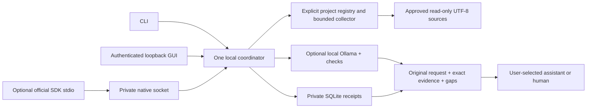

# Architecture and current contracts

The evidence core remains offline by default. Version 0.2 adds an optional bounded Ollama worker, conservative owner-profile routing and a packaged local GUI. No provider account or application-specific integration is required.

## Source capture

`config.py` accepts a closed TOML configuration with up to sixteen nonoverlapping roots and a separate state directory. `policy.py` opens root ancestors and relative file components with no-follow POSIX descriptor operations. Hidden paths, credential filenames, hard links, special files and oversized files are denied. A heuristic secret screen examines the entire bounded file before any excerpt is published. It does not redact or silently alter exact source.

Files are UTF-8. Line numbers use LF separators with optional preceding CR preserved, starting at one. A terminal LF closes the preceding line; it does not create a phantom additional line. Whole-file and excerpt SHA-256 values, path and range produce a deterministic evidence identity. In-place metadata and path identity are rechecked after capture. Hashes are not signatures, repository revisions or an atomic multi-file snapshot.

## Jobs and storage

`engine.py` owns admission, a single worker thread, a cancellation event and a cooperative deadline. The database terminal transition only succeeds from `running`; cancellation cannot be overwritten by late work. A terminal job cannot be cancelled retroactively. A newly admitted task may need to wait briefly for a cancelled worker to unwind.

`store.py` holds an exclusive advisory owner lock. A second cooperating process refuses startup. Each operation uses a serialized SQLite transaction. The next exclusive startup marks leftover running jobs failed with `interrupted`, without resuming them. The database binds receipts to project ID plus the configured root path/device/inode. Relabeling a project ID onto another root does not expose old receipts. A store remains private to its owning OS account; project IDs are not multi-user authentication.

Evidence is embedded in the captured packet, rather than duplicated in a second cache. `fetch_evidence` requires project, job and evidence IDs and returns the captured snapshot. It does not reread current source or claim freshness. No embedding index, lesson store or Git subprocess exists in this slice.

## Entry points

The CLI, GUI and optional MCP adapter call the same Engine methods. The GUI owns a coordinator and a private native connection publication; MCP `--connect` reaches that exact Engine. Diagnostic MCP `--config` owns a separate Engine and cannot concurrently own the same store. The four native tools cannot change root/configuration grants or invoke a shell/provider. Only an explicit GUI launch starts its loopback browser listener.

Optional lexical discovery reads at most 200 supported files/4,000 directory entries/eight levels within a cooperative five-second scan budget. Selected source is recaptured and hash-checked before publication. Up to two distant windows per file may fill four source slots; different files are prioritized. Cutoffs/exclusions are disclosed, and a no-match job abstains. Discovery is a relevance aid, not an exhaustive review.

After source capture, `off` makes no Ollama requests. `best` applies owner-controlled qualification gates. `trial` uses an explicit installed tag/digest. Model schema, source IDs, runtime/model identities and budgets are checked; failed notes are discarded without losing the exact packet. No note or confidence statement marks the task solved. See [routing](ollama-routing.md) for limits and [the workbench](workbench.md) for sessions and sharing.

## Result semantics

| Status | Meaning |
| --- | --- |
| `running` | Work was admitted and has not reached a terminal state. |
| `prepared` | Every requested range was captured; interpretation remains open. |
| `incomplete` | Some or all ranges were refused; the packet lists every gap. |
| `cancelled` | Work was stopped; no completed packet is available. |
| `failed` | Deadline, interruption or unexpected failure; no completed packet. |

The receipt reports actual excerpt bytes, local elapsed time, model-attempt count, Ollama-request count and available local runtime token counts. Cloud calls remain zero. Unknown usage and savings are `null`. It makes no token approximation, quality score or review-completion claim.
