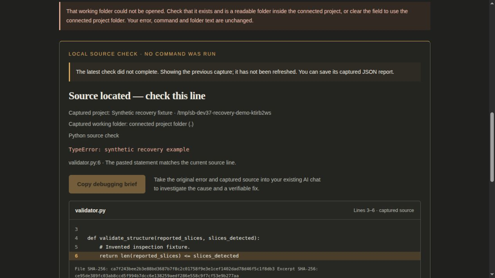

# Keep usable evidence through a failed retry

November 11, 2026 · `0.4.0.dev37`, following the dev36 workbench changes.

Two reproducible recovery defects could hide usable evidence. Starting a second failed-run check erased the first report before the response arrived; a timeout, refusal or invalid response left no report to save. Separately, source-brief history treated every native `DONE` task as prepared, including a denied task. On reload, that newer failure prevented automatic restoration of an earlier usable capture. An editable Preparation mode could also be silently reset by the initial connection response.

## Behavior

- The failed-run page retains its last accepted report until a valid current response replaces it. A visible notice distinguishes an earlier capture while a check is pending, fails, or becomes obsolete. Source, original output, project identity, hashes and credential warnings remain attached to that capture.
- Copy, text export and manual-copy review wait while a check is pending or inputs differ. **Download captured JSON report** saves the displayed report even in those states. It never includes newer unsent edits. After an unsuccessful same-input recheck, the earlier capture can be copied again with the notice that it was not refreshed.
- A malformed or wrong-input response does not replace the report. Existing input-revision and session-generation guards still reject obsolete responses. No check, source preparation, connection approval or model call is replayed automatically.
- Source-task history retains actual outcome and evidence availability from the existing bounded result read. A denied/error result is failed; a successful result without excerpts is incomplete. Startup restores the latest prepared/incomplete capture. Older metadata without these facts is labelled completed and remains reviewable in history, without a prepared claim. The historical inert demo still renders its explicit recorded result.
- Preparation mode is disabled until the session and saved choices are ready, and during unconfirmed settings or a disconnected session. Existing mode/model choices are restored before editing becomes available.

This retains one failed-run report in the open tab and the existing limited source-job history in the running service. A valid successful replacement supersedes the previous failed-run report. Save required JSON before replacement, reload or tab closure. Service restart does not restore session-only folder approvals or make older source current. Durable jobs, browser-wide history and result persistence are not added.

## Reproduction and verification

The new regressions first reproduced the failures against the previous implementation. The failed-run case used the actual script with an initial accepted synthetic report followed by an identical check that timed out. The source-history case used a real controller: prepare evidence, remove the disposable project folder, then prepare again and reload. The second task is `DONE/DENY`, not a prepared capture. A held initial-state response reproduced the editable mode reset without a model call.

Validation passed:

- **516 Python tests** on Python 3.12, Python 3.14 and an isolated installed wheel with `PYTHONPATH` unset. The final caption revision was followed by the full source/installed Python suites again.
- **134 browser scenarios** against source and installed builds: 14 readiness, 5 clipboard, 46 workbench, 55 failed-run, 13 session recovery and 1 real excerpt/export walkthrough. The failed-run script invokes recovery once. The final installed failed-run/recovery suite also passed after the source caption changed from “captured now” to “captured source”. The new coverage is three workbench cases, seven failed-run cases and one real-restart case.
- **75 JavaScript checks** for clipboard/activity, request deadlines and model readiness, plus frontend API, file-launch and server-startup checks. Existing synthetic selection and evidence-only Task Lab checks also pass. These remain mechanical evidence, not model accuracy or savings measurements.
- Wheel code/assets/legal bytes match source; no core runtime dependencies were added. Final wheel SHA-256: `7b81c78150176be05d3f716d2ea9176eb28a889b0cbc056467feb53c344fa2bc`.
- Installed demo/shared-state smoke and official SDK 2.3.0 in-process/shared/stdio-subprocess checks passed. The subprocess receipt reports five tools, zero model calls, zero cloud calls and successful publication cleanup. Local AI off survives restart with isolated settings.

The root reviewer also operated the installed preview with a disposable synthetic folder: capture one report, select a nonexistent working folder, receive the real refusal, then download the retained JSON. The two downloads were byte-for-byte identical, retained the original blank working-folder input and contained the same captured source/hashes. The newer failed input remained on the page. This is a real service/browser check with invented source, separate from injected transport failures. The screenshot below retains the refusal, earlier-capture label, disabled copy action and captured source. Temporary viewport overrides were reset; the retained screenshot uses the normal viewport.

The checks use synthetic source and isolated settings; they do not qualify private-source handling, diagnosis/repair accuracy, actual model or host failures, power-loss recovery, assistive technologies, representative usability or whole-task savings. UX-01, UI-01, REL-01, ACC-01, ACC-02 and MET-01 remain open. The original checkout and owner installation were not changed. Hosted CI, merge and owner installation remain separate states reported on the pull request.
