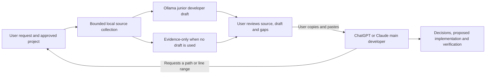

# Local junior developer, main developer handoff

Accepted product direction, November 11, 2026. Implemented in the merged `0.4.0.dev38` source; see [current status](current-status.md), [implementation validation](junior-main-workflow-2026-11-11.md) and the subsequent [local screening failures](junior-model-screening-2026-11-11.md). The [original owner record and exact clarification](planning/source-record.md) remain separate from implementation evidence.

Shake & Bake exists to let a locally running Ollama model do junior developer preparation before the user pastes a compact handoff into ChatGPT or Claude as the main developer. The intended benefit is less paid-model context, repeated investigation and correction work while preserving final-task quality. Whole-task token, quota and financial benefits remain unqualified.

## Division of responsibility

| Participant | Responsibility | Boundary |
| --- | --- | --- |
| User | Supplies original intent, approves project scope, chooses a local model, reviews the brief and pastes it into the chosen chat. | Collection or model selection does not authorize execution, installation, cloud automation or release. |
| Deterministic application | Collects exact source, locations, hashes and omissions; checks output shape and citations; preserves the request and records. | Read-only toward inspected repositories. Citation/schema checks do not validate a model's conclusions. |
| Ollama: junior developer | Studies supplied excerpts; drafts the goal, evidence priorities, specific asks, suggested approach, concise cited notes and unresolved questions. | No tools or command authority. Cannot choose roots, change policy, certify unseen files, edit code or make final implementation decisions. |
| ChatGPT or Claude: main developer | Reviews the junior's work against source, investigates beyond it, makes diagnosis/design/implementation decisions, proposes changes and defines verification. | The pasted brief grants no live project access or execution permission. Further actions require actual access and user authorization. |

“Junior developer” describes a preparation role. This version adds no autonomous coding agent, repository writes, test execution or private reasoning exports. “Main developer” describes the receiving assistant's role in the user's existing chat; the app does not control that service.

## Primary journey and supporting paths

The main path is **Prepare source brief → local preparation → review → Copy brief → paste into ChatGPT or Claude**. The Local AI control is visible beside the task; candidate/readiness controls are under **Model details**. Local AI starts off on new installations and retains an existing saved choice. This direction does not promote an unqualified model or silently contact a daemon.

**Best tested** requires reviewed profiles bound to pipeline/model identity; none is currently qualified. For an explicit trial, launch with `--allow-candidate-trials`, enable Local AI, choose **Try a candidate — unqualified**, refresh installed models, choose a candidate and acknowledge the trial. The trusted local daemon must have cloud features disabled; the checkbox does not attest daemon isolation. No automatic download, cloud model, browser-chat automation or provider fallback is added.

Evidence-only preparation supports the workflow when no model is used or no acceptable draft is available. The result and copied handoff say so. **Diagnose a failed run** also supports it: deterministic parsing locates source for the main developer with no Ollama call. A source location does not establish a cause or fix. The optional stdio adapter remains an advanced, separately scoped transport; manual copy/paste is the primary journey.

| Components | Contribution to the purpose |
| --- | --- |
| `collector.py`, `search.py` | Bounded collection with exact excerpts, identities and explicit gaps. |
| `worker.py` | Ollama junior developer instructions and validated output, identified as `junior_developer_handoff_v2`. |
| `briefing.py` | CLI orientation/full-evidence handoffs with main-developer instructions and truthful model participation. |
| `web/index.html`, `web/app.js` | Source preparation first, visible Local AI, draft/evidence review, clipboard/text/JSON handoff. |
| `troubleshoot.py`, `web/troubleshoot.js` | Evidence-only debugging handoff with original errors, source and missing locations. |
| `routing.py`, `helper.py`, `gui.py` | Owner scope, explicit model/trial selection, identity checks, cancellation and fallback. Role labels grant no authority. |
| `mcp_server.py`, `shared.py` | Optional native-client transport over the existing coordinator; no automatic consumer-chat integration or cloud calls. |
| `tests/`, `scripts/`, `benchmarks/` | Synthetic mechanical checks, distinct from actual-model quality, host qualification and whole-task benefit. |

Captured evidence stays local; only the bounded worker copy goes to an explicitly selected local model. The compact text layout can omit some captured excerpts; full evidence and JSON remain available. The main developer can ask for missing paths/ranges. Never silently shorten original intent, exact captured records, contradictions or uncertainty to meet a token target.

## Acceptance and measurement

| Requirement | Evidence required |
| --- | --- |
| Consistent roles | Start screen, worker prompt, result, CLI text and both browser layouts distinguish junior preparation from main-developer decisions. |
| Truthful participation | Success, Local AI off, no qualified profile, invalid output and worker failure disclose the actual route. Failed-run checks never imply an Ollama run. |
| Useful handoff | Original request, source-backed starting points, unverified advice, gaps and specific next-source questions; explicit user copy/paste. |
| Preserved boundaries | Exact request/source/hashes remain intact; source/model content stays fenced reference data; no hidden provider calls or project execution. |
| Final-task quality | Paired fresh tasks, equal allowed source/tool access, same receiving model/settings; score final results, critical misses, unsupported claims and corrections. Permit no additional critical misses or lost baseline successes in the defined cohort. |
| Reduced paid-model work | Count all available cloud input/output/reasoning, schemas, retrieval, retries, follow-ups and corrections. Keep local usage separate and missing usage unknown. |
| Practical benefit | Include local preparation and total completion time; retain slower/worse runs. Provider quota observations and actual billed costs require separate records. |

Cloud-token reduction is `1 - assisted_total_cloud_tokens / baseline_total_cloud_tokens` for comparable completed tasks. Report the paired distribution, quality gates, failures and missing accounting. Keep the original planning target of at least 50% median reduction alongside no quality regression and no increase in median completion time as an acceptance target, not a measured result or promise.

The UI's bytes/4 estimate describes one outgoing brief, excluding the receiving model's answer, reasoning and later context/retries. It cannot establish billed savings or a change to a fixed subscription fee. [Retained evaluations](evaluation-status.md) include failed quality/efficiency gates; earlier prompt/layout results do not qualify dev38's changed instructions and framing. New development trials and separate human review are required before a reserved cohort or model promotion.

## Architecture decision

Manual copy/paste works with the user's existing chat without adding a paid API dependency or transmitting source automatically. Optional native adapters are advanced transport rather than prerequisites. Evidence-only collection remains available because unavailable/unqualified model output cannot count as completed junior work. Read-only preparation remains the scope; execution and implementation belong to a separately authorized workflow with the main developer.
