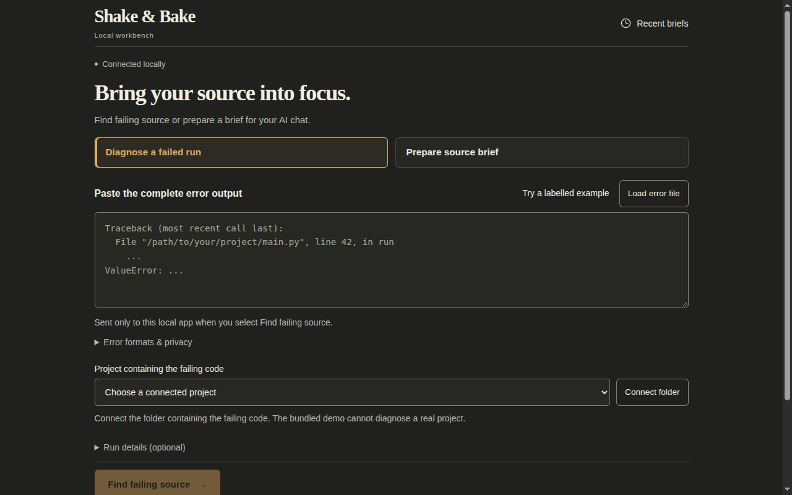
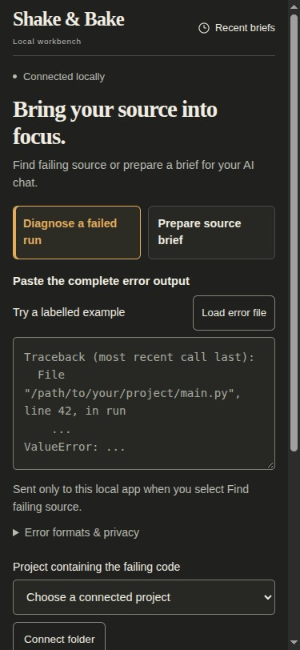

# A smaller workbench with clearer recovery

November 11, 2026 · `0.4.0.dev36`, based on merged main `00cb89806e63d928b20eca27e2ef7fd2106cb455`.

The main job is now easier to reach: choose an error or a source question, enter it, choose a project, then explicitly prepare and review the evidence. Optional controls stay available without competing with that path. This is the existing standalone application, with its existing visual identity and backend boundaries.

## What changed

The opening works for both workflows. Compact task choices replace repeated explanatory cards; format and full privacy guidance remain in native help. Optional command and working-folder fields live in **Run details (optional)**. Their exact values are still captured when the disclosure is closed, and a working-folder error reopens the fields and focuses recovery. Folder connection is beside each project selector and opens the one existing connection form; it does not approve or inspect a folder automatically.

Help text is at least 14 CSS pixels, common controls retain 44-pixel targets, and the existing warm charcoal/ivory/amber palette, local assets, keyboard outlines and reduced-motion behavior remain. The selected task and its action stay clear at narrow widths. Generic source-check boundary facts are expandable; the core caution, missing-location count and cutoff disclosures remain visible.

Three behavior repairs accompany the layout:

1. **Copy feedback follows exact text.** A pending or completed clipboard attempt can no longer claim to have copied the currently displayed layout after the layout changes. It names an earlier layout or job when appropriate, including failures. Returning A→B→A is current only when the bytes match. The shared one-unsettled-write guard remains.
2. **Preparation stays visible across workflows.** One activity banner names the captured project and actual starting/running/unknown state. View preparation reveals the existing job and Stop action. A conflicting failed-run check is disabled without disabling edits; a service-busy race refreshes state read-only and gives a wait/stop action without replaying work. No percentage, ETA or invented backend stage is shown.
3. **Each error keeps its association.** Matching details now label frames and explicitly associated exceptions; debugging text includes parsed exceptions, chain relations, frame IDs, evidence IDs and validated association indexes. Absent, invalid or cross-chain associations remain unknown. An unsupported nested member cannot borrow a neighboring error message. Original output and JSON retain their exact captured data.

## Current audit and layout observations

The root reviewer captured and operated both workflows in the in-app browser using disposable synthetic source. The audit steps were:

| Step | Captured experience | Observed health after this change |
| --- | --- | --- |
| 1 | First visit and task choice | Compact entry, clearly selected task, no automatic use of the demo for a real error |
| 2 | Labelled example, project selection and optional run details | Explicit source check; optional values retained; folder connection/recovery preserves inputs |
| 3 | Captured source and debugging handoff | Exact source, hashes, missing evidence, error identities and next checks available; copied text is still a manual handoff |
| 4 | Source question, prepared brief, copy and workflow switching | Existing preparation remains visible; copy feedback follows displayed text; drafts and prior results remain distinct |

Matched first-visit measurements used empty error input, no connected real project, no result, closed disclosures and the same browser/viewport for each version. These are layout coordinates, not task-time or accuracy measurements:

| Measurement in CSS pixels | dev35 | dev36 |
| --- | ---: | ---: |
| Desktop 1280×800: top of error input | 625.73 | 342.91 |
| Desktop 1280×800: top of main action | 1156.75 | 759.08 |
| Phone layout 375×812: top of error input | 823.38 | 420.52 |
| Phone layout 375×812: top of main action | 1512.91 | 946.47 |
| Desktop help-text size | 11.9 | 14 |

The initial design pass still placed the desktop action around 1048 pixels down; separate design review requested further compaction. The revised screenshot/source review passed. That reviewer could not operate its browser backend and used fresh root captures instead; the root's interactive checks and automated browser tests are separate evidence. All participating agents use the same model provider; no cross-provider or independent human design qualification is claimed.

The [previous desktop capture](workbench-2026-11-11/before-desktop.jpg) and current captures contain only the synthetic starting screen. Screenshots are retained as exact browser captures. Temporary viewport overrides were reset after checks. Root checked layouts at 320, 375, 768 and 1280 pixels without horizontal page overflow. Short windows and phones still require normal vertical scrolling. This is viewport emulation, not physical-phone or complete accessibility qualification.

## Regression and installed evidence

- All **515 Python tests** passed on Python 3.12, Python 3.14 and the isolated installed dev36 application with `PYTHONPATH` unset.
- All **123 browser scenarios** passed against final source and again against the isolated installed wheel: 14 readiness, 5 clipboard, 43 workbench, 48 failed-run, 12 session-recovery and 1 real excerpt-budget/export walkthrough. Recovery is invoked by the failed-run script and counted once. New coverage adds one workbench and six failed-run scenarios.
- **75 JavaScript checks** passed across clipboard/activity (39), request deadlines (6) and model readiness (30), plus existing frontend, file-launch and browser-server checks. The expanded 39-case clipboard/activity suite passed 27 and failed 12 against the previous code; all 39 pass with the changes.
- Wheel-byte/asset/license verification passed. The wheel SHA-256 is `ed2621b028644cbe6fa6f5b5a4c8ed49544c2799c3028c6824b97026a0ef51df`. It was installed in a new environment without core runtime dependencies. Installed demo/shared-state checks passed, including retained Local AI off across restart.
- With hash-locked official SDK 2.3.0 dependencies, in-process, shared-service and actual stdio-subprocess smoke checks passed. The subprocess receipt reports no model or cloud calls. No MCP interface changed.

The initial Python check found the existing page-asset assertion still expected the old heading; its expected text was updated. The first new workbench scenario also exposed a counter in its own higher-priority mocked route bypassing the shared request counter; the instrumentation was corrected while retaining the exact-one-start assertion. Both initial failures remain in local logs; final suites pass. No application failure was hidden by weakening a behavior assertion.

The live review preview runs the isolated installed package. The owner's installation, original checkout, private planning exports and project source were not changed. No dependencies, model calls, remote execution, source writes or public listener were added to the product. Hosted CI and merge state are reported separately on the pull request.

Representative usability research, assistive-technology testing, physical devices, real-model/host accuracy, private-source qualification, durable jobs and whole-task savings remain open. This pass does not close UX-01, UI-01, ACC-01, ACC-02 or MET-01, or authorize model/profile promotion.
